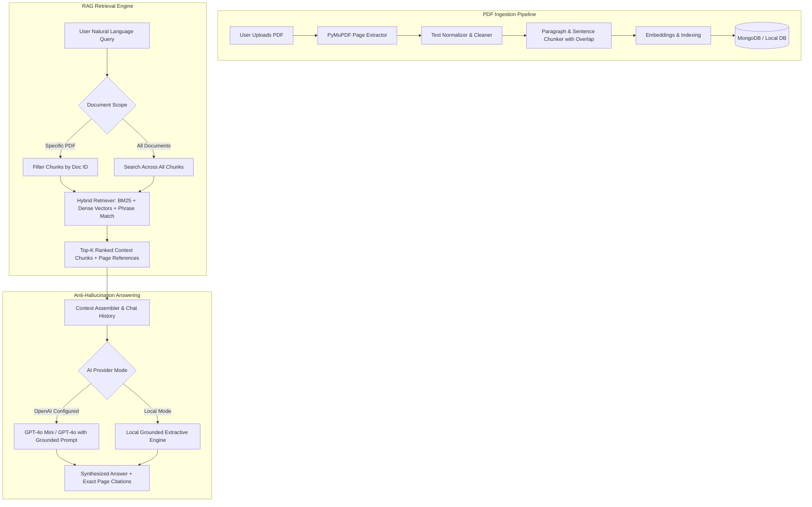

# DocuChat AI — Intelligent PDF Question Answering System

> **A modern, full-stack AI-powered document intelligence web application that allows users to upload PDF documents and ask questions in natural language, receiving context-aware, anti-hallucination answers grounded in exact document pages.**

---

## 📑 Table of Contents

1. [Project Overview](#-project-overview)
2. [Key Features](#-key-features)
3. [Architecture & RAG Pipeline](#-architecture--rag-pipeline)
4. [Technology Stack](#-technology-stack)
5. [Installation & Setup](#-installation--setup)
6. [Environment Variables](#-environment-variables)
7. [Running the Application](#-running-the-application)
8. [Database Configuration (MongoDB & Local Storage)](#-database-configuration)
9. [Configuring External AI (OpenAI & Pinecone)](#-configuring-external-ai)
10. [Example Questions & Queries](#-example-questions--queries)
11. [Anti-Hallucination Guardrails](#-anti-hallucination-guardrails)
12. [Troubleshooting](#-troubleshooting)
13. [Future Improvements](#-future-improvements)

---

## 🎯 Project Overview

DocuChat AI solves the problem of finding and synthesizing information from dense multi-page PDF documents. Users can drag and drop PDFs, automatically extract and chunk text while preserving page numbers, and interactively query documents using natural language.

The application is built with a **modular Retrieval-Augmented Generation (RAG)** architecture:
- Works **out of the box with zero external API keys** via its built-in **Local Grounded Engine** and **hybrid BM25/Dense retrieval**.
- Seamlessly transitions to **OpenAI GPT-4o / Pinecone vector database** by providing environment keys or configuring them through the in-app UI modal without restarting or rewriting code.

---

## 🚀 Key Features

- **Multi-Stage PDF Processing Pipeline**:
  - `Uploading...` → `Extracting text...` → `Processing pages...` → `Creating chunks...` → `Indexing document...` → `Ready to chat ✓`
  - Page-by-page extraction using **PyMuPDF (`pymupdf`)** preserving 1-indexed page references.
  - Automatic deduplication via SHA-256 content hashing to avoid redundant processing.
- **Intelligent Hybrid Search & Retrieval**:
  - Combines **BM25 term frequency**, **dense n-gram vector embeddings**, and **exact phrase matching**.
  - Multi-document cross-search: query a specific document or select **"All Documents"** to aggregate answers across an entire repository.
- **Anti-Hallucination Guarantee**:
  - Explicit system prompt instructions and strict relevance thresholding.
  - If a requested fact is not present in the document, it responds:
    `"I couldn't find information about this in the uploaded document."`
- **Exact Source Citations**:
  - Every answer includes source cards showing the **document filename**, **page number tag**, and an expandable snippet of cited text.
  - Interactive "Preview PDF" drawer jumping straight to cited pages.
- **Conversational Memory & Follow-up Support**:
  - Maintains conversation history across turns, allowing pronoun resolution (e.g., *"What is supervised learning?"* followed by *"What are its advantages?"*).
- **Dual Database Layer**:
  - Connects to **MongoDB** if active; automatically activates a **zero-dependency persistent local JSON storage engine** if MongoDB is offline.
- **Polished SaaS UI**:
  - Responsive Tailwind CSS design with landing page, analytics dashboard, document repository, chat sidebar, and live status pills.

---

## 🏗 Architecture & RAG Pipeline



---

## 🛠 Technology Stack

### Backend
- **Python 3.11+**
- **FastAPI**: Asynchronous high-performance REST API.
- **PyMuPDF (`pymupdf`)**: Fast, accurate page-level PDF parsing.
- **Motor / PyMongo**: Async MongoDB driver.
- **rank-bm25 & NumPy**: Hybrid text retrieval and vector scoring.
- **OpenAI Python SDK**: Optional generative completion and embeddings.
- **Uvicorn**: ASGI web server.

### Frontend
- **React 19 & TypeScript**
- **Vite 8**: Next-generation bundler with instant HMR.
- **Tailwind CSS v4**: Modern utility-first styling.
- **Lucide React**: Clean icons for document types, statuses, and navigation.

---

## 📦 Installation & Setup

### Prerequisites
- **Python 3.11+** installed.
- (Optional) **Node.js 20+** if modifying frontend components.
- (Optional) **MongoDB** instance running locally or via MongoDB Atlas.

### 1. Clone or Navigate to the Project
```bash
cd docuchat-ai
```

### 2. Backend Setup
Create and activate a virtual environment (optional) and install dependencies:
```bash
cd backend
pip install -r requirements.txt
```

---

## ⚙️ Environment Variables

Create or edit `backend/.env` (a `.env.example` is provided at the root):

```env
# Database Configuration
# Connects to MongoDB if available; seamlessly falls back to persistent local storage if offline
MONGODB_URI=mongodb://localhost:27017
MONGODB_DB_NAME=docuchat

# AI Provider: 'local' (zero keys required) or 'openai'
AI_PROVIDER=local

# OpenAI API Key (Required only if AI_PROVIDER=openai)
OPENAI_API_KEY=
OPENAI_MODEL=gpt-4o-mini
OPENAI_EMBEDDING_MODEL=text-embedding-3-small

# Vector Database (Optional - Pinecone)
PINECONE_API_KEY=
PINECONE_INDEX_HOST=
PINECONE_INDEX_NAME=

# Upload & Chunking Parameters
UPLOAD_DIR=uploads
MAX_UPLOAD_SIZE_MB=30
CHUNK_SIZE=800
CHUNK_OVERLAP=150
TOP_K_CHUNKS=5
```

---

## 🚀 Running the Application

### Option A: One-Command Full Application Launch
Because FastAPI serves the compiled React production frontend, you can run the entire system with a single Python command:

```bash
cd backend
python run.py
```
Open your browser and navigate to:
👉 **`http://127.0.0.1:8000`**

### Option B: Frontend Development Mode (Hot Reloading)
To run the React development server with hot-module replacement:

1. Start the backend:
   ```bash
   cd backend
   python run.py
   ```
2. In a separate terminal, start the frontend:
   ```bash
   cd frontend
   npm run dev
   ```
👉 **`http://localhost:5173`** (API requests are automatically proxied to port 8000).

---

## 🗄️ Database Configuration

DocuChat AI includes an enterprise dual-storage strategy:
1. **MongoDB Server**:
   - If a MongoDB server is reachable at `MONGODB_URI`, it creates indexed collections: `documents`, `document_chunks`, `chats`, `messages`.
2. **Local Persistent JSON Store Fallback**:
   - If MongoDB is not active or installed on the system, the application activates its local storage engine in `backend/data/` (`documents.json`, `document_chunks.json`, `chats.json`, `messages.json`).
   - The UI displays a status badge indicating whether MongoDB or Local Storage is currently active.

---

## 🤖 Configuring External AI

To enable external OpenAI GPT-4o and Pinecone vector search:

### Method 1: Via Environment Variables
In `backend/.env`:
```env
AI_PROVIDER=openai
OPENAI_API_KEY=sk-your-openai-api-key-here
OPENAI_MODEL=gpt-4o-mini
```

### Method 2: Via In-App Settings Modal
1. Click the **Gear icon (⚙️)** in the top right navbar.
2. Select **OpenAI LLM**.
3. Paste your OpenAI API Key and select your preferred model (`gpt-4o-mini`, `gpt-4o`).
4. Click **Save Settings**. The backend updates its active configuration dynamically without server restarts!

---

## ❓ Example Questions & Queries

The system comes pre-seeded with 4 sample documents:
- `Machine_Learning.pdf`
- `DBMS.pdf`
- `Computer_Networks.pdf`
- `Artificial_Intelligence.pdf`

Try these queries:

### Direct Document Questions
1. *"What is supervised learning?"*
   - Cites `Machine_Learning.pdf — Page 1, Page 2`
2. *"What are the advantages of supervised learning?"*
   - Cites `Machine_Learning.pdf — Page 2`
3. *"What are the ACID properties in databases?"*
   - Cites `DBMS.pdf — Page 1`
4. *"Explain the difference between TCP and UDP."*
   - Cites `Computer_Networks.pdf — Page 2`

### Follow-up Questions
- Turn 1: *"What is supervised learning?"*
- Turn 2: *"What are its advantages?"* (Resolves *"its"* to supervised learning using conversational context).

### Anti-Hallucination Testing
- Ask: *"Who invented TCP?"*
- Response: **`"I couldn't find information about this in the uploaded document."`**

---

## 🛡️ Anti-Hallucination Guardrails

1. **Strict Context Grounding**: The LLM prompt explicitly commands:
   > *"Answer the user's question using ONLY the provided document context. If the answer cannot be found in the provided context, clearly state that the information could not be found in the uploaded document. Do not invent facts."*
2. **Relevance Thresholding**: If the top retrieved chunks have a matching score below threshold, the system immediately returns the unsupported state without hallucinating.
3. **Local Mode Transparency**: When running in local mode without an API key, the system uses extractive synthesis and labels the response with a notice.

---

## 🔧 Troubleshooting

| Issue | Resolution |
| :--- | :--- |
| **`MongoDB not active` warning** | Normal in offline mode. DocuChat AI automatically uses `backend/data/` persistent storage. To use MongoDB, start your local `mongod` service or provide a MongoDB Atlas URI in `.env`. |
| **`This PDF does not contain extractable text`** | The uploaded PDF is a scanned bitmap or image without an OCR layer. Upload a digital/text-based PDF. |
| **`PDF is encrypted`** | PyMuPDF rejects password-protected PDFs. Decrypt or print-to-PDF before uploading. |
| **Frontend port conflict** | If port 5173 is busy, Vite will automatically select the next available port (e.g. 5174). |

---

## 🔮 Future Improvements

- Optical Character Recognition (OCR) fallback for scanned image PDFs via Tesseract.
- Export conversation transcripts to PDF or Markdown.
- Semantic reranking using Cohere Rerank or Cross-Encoders.
- Multi-user authentication and team workspaces with role-based access control (RBAC).

---

&copy; 2026 DocuChat AI. Built for reliable, grounded document intelligence.
